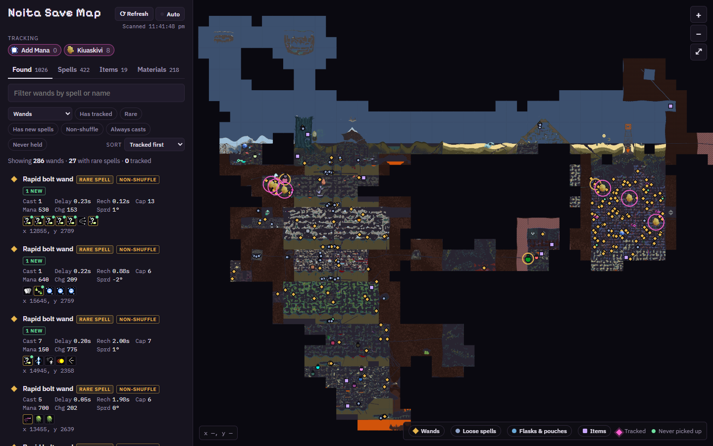
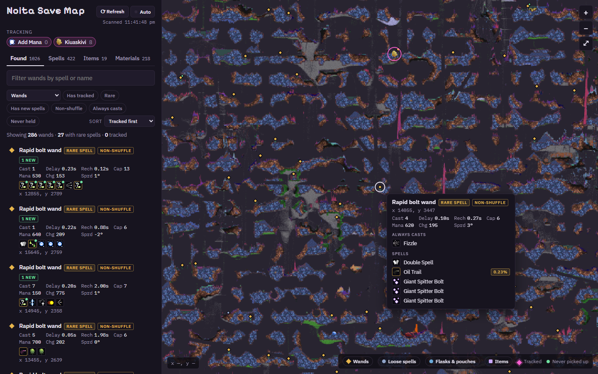
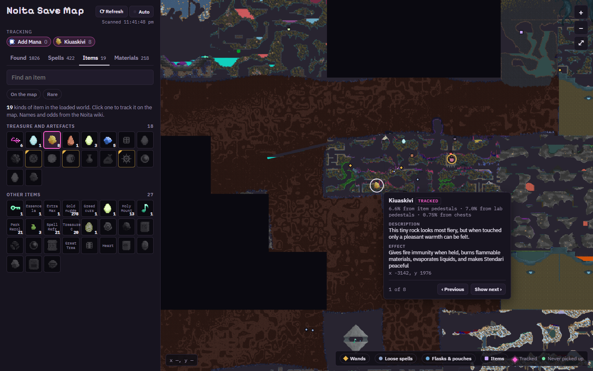
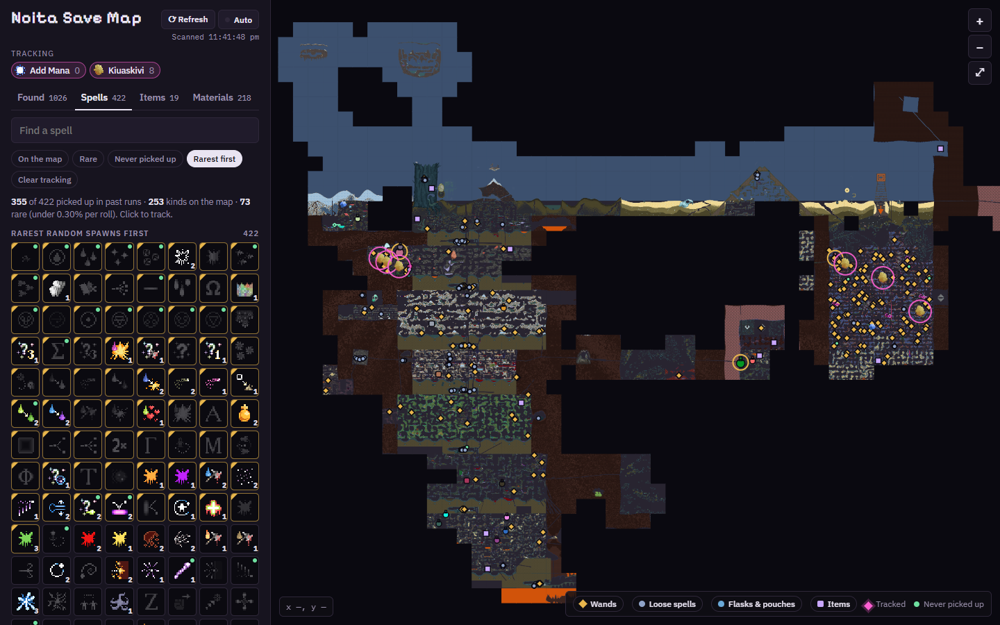
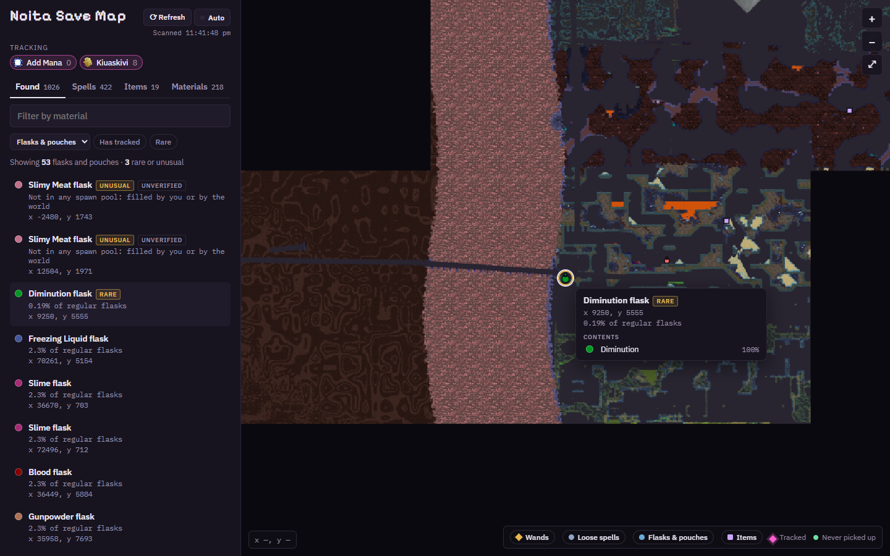
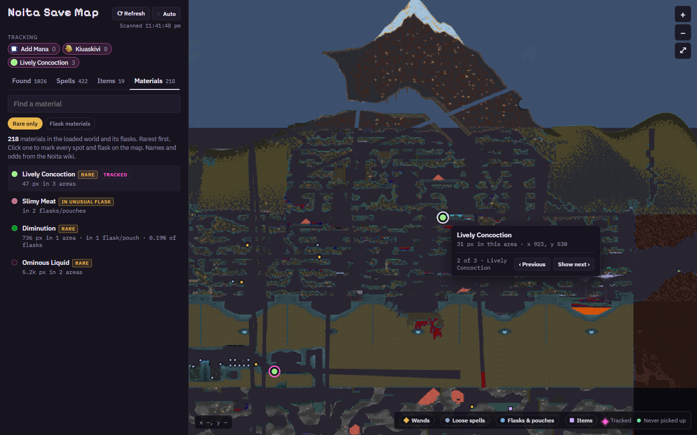

# Noita Companion

A map of your Noita save that refreshes while you play: every wand (with stats and always-casts), loose spell, flask, pouch and item the game has loaded, with spell, item and material tracking and rarity from the Noita wiki.

## Screenshots

| | |
|---|---|
|  |  |
| **Wands**: stats, always-casts and spells, with rare spells flagged by their spawn odds | **Items**: track anything from the wiki's item list and step through every copy |
|  |  |
| **Spells**: every spell, rarest first, with counts on the map and ones you've never picked up | **Flasks & pouches**: contents and odds, with rare and unusual ones called out |
|  | |
| **Materials**: rare materials in the world and in flasks, marked on the map | |

## Download

**[Download Noita-Companion.exe](https://github.com/treeko11/noita-companion/releases/latest/download/Noita-Companion.exe)** (Windows 10/11), or see [all releases](https://github.com/treeko11/noita-companion/releases).

Needs Noita installed through Steam and the Microsoft Edge WebView2 runtime (already on most PCs). The exe isn't code-signed, so Windows SmartScreen may say "Windows protected your PC": choose **More info → Run anyway**.

## Using it

Run `Noita-Companion.exe` (or `dist\Noita Companion.exe` if you built it yourself). It finds your save (`%USERPROFILE%\AppData\LocalLow\Nolla_Games_Noita\save00`) and your Steam install of Noita on its own and opens in its own window.

- The first start draws every explored area (around 20–60 seconds). Later starts take seconds.
- **Refresh** rescans now; **Auto** rescans every 10 seconds. The game writes areas to disk every few minutes while you play, so the area around you can lag behind.
- Tabs: **Found** (wands, loose spells, flasks & pouches, other items), **Spells**, **Items** and **Materials** libraries. Click any spell, item or material to track it. Click a marker, then **Show next** to step through all copies.
- The legend toggles map layers.

Its cache, settings and wiki data live in `%LOCALAPPDATA%\NoitaCompanion`. Delete that folder to start fresh.

Options (from a command prompt): `--browser` opens it in your web browser instead of a window, `--save <folder>` and `--wak <path to data.wak>` point it at a different save or install, `--export <folder>` writes a static snapshot page.

## Where the data comes from

- Spell, material and item names, icons and spawn odds: the Noita wiki (noita.wiki.gg), cached for a week and shipped inside the app for offline use.
- From the game files (`data.wak`): only the textures used to draw the map, and the material numbering the save uses for flask contents.

## Credits

- Spell, item and material data and descriptions (`wiki_cache.json`) come from [the Noita Wiki](https://noita.wiki.gg/), available under [CC BY-NC-SA 3.0](https://creativecommons.org/licenses/by-nc-sa/3.0/).
- The icons in `seed_icons/` are Noita's own sprites, © Nolla Games, fetched from the wiki.
- This is an unofficial fan tool, not affiliated with Nolla Games.

## Rebuilding

Run `build.bat`. It sets up a private Python environment in `.venv`, refreshes the bundled wiki data, and writes a new `dist\Noita Companion.exe`. To run from source instead: `python companion.py` (opens in your browser).

Files: `companion.py` (app and local server), `noita_wands.py` (reads items from the save), `noita_map.py` (draws the map), `noita_decomp.py` (save decompression), `wak.py` (reads `data.wak`), `wiki_data.py` (wiki data), `map_template.html` (the interface).
